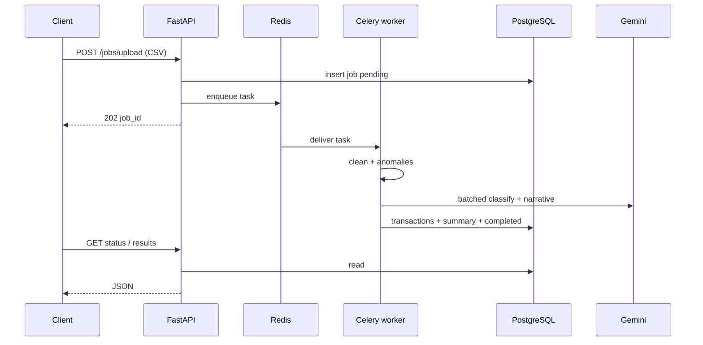

# AI Transaction Pipeline

Asynchronous backend that accepts messy financial CSVs, cleans them, flags anomalies, classifies spend with an LLM, and returns structured job results — FastAPI + Celery + Redis + Postgres, fully Dockerised.

## Problem

Finance ops often receive inconsistent transaction exports (mixed date formats, currency symbols, blank categories, duplicates). Synchronous request handling ties up the API while Pandas and LLM calls run. This service accepts an upload, returns a `job_id` immediately, and processes work on a Celery worker.

## Features

- `POST /jobs/upload` → immediate `202` with `job_id`
- Celery worker pipeline: clean → anomaly detect → batched LLM classify → narrative summary → persist
- Date/amount/status normalisation; duplicate drop; blank category fill
- Anomalies: per-account median outlier (3×) and domestic-brand/USD cross-border heuristics
- Gemini batched classification (20 rows/call) with exponential backoff; `llm_failed` flag on hard failure
- Job status + full results endpoints; list/filter jobs
- Docker Compose: API, worker, Postgres 16, Redis 7 with health checks

## Architecture



## Tech stack

| Layer | Choice |
|---|---|
| API | FastAPI, Pydantic v2, uvicorn |
| Queue | Celery 5 + Redis 7 |
| DB | PostgreSQL 16, SQLAlchemy 2 (async API / sync worker paths) |
| Data | Pandas, NumPy |
| LLM | Google Gemini (`google-generativeai`) |
| Ops | Docker Compose, multi-mode Dockerfile (`MODE=web|worker`) |

## Key engineering decisions

1. **Upload is never the slow path.** Heavy work is Celery-only so the API stays responsive.
2. **Batch LLM calls.** Classification sends up to 20 rows per request to stay within free-tier rate limits and cut cost versus per-row calls.
3. **Heuristic anomalies before LLM.** Median outliers and brand/currency checks do not need a model and stay explainable.
4. **Graceful LLM failure.** Rows can complete with `llm_failed=true` rather than failing the whole job.
5. **Compose as the contract.** One `docker compose up --build` brings API, worker, broker, and database online together.

## Getting started

### Prerequisites

- Docker Desktop (or Docker Engine + Compose)
- `GEMINI_API_KEY` from Google AI Studio

### Run

```bash
git clone https://github.com/darkNIGHT669/ai-txn-pipeline.git
cd ai-txn-pipeline
cp .env.example .env
# set GEMINI_API_KEY=
docker compose up --build
```

API: [http://localhost:8000](http://localhost:8000) (OpenAPI at `/docs`).

Sample upload:

```bash
curl -X POST http://localhost:8000/jobs/upload -F "file=@transactions.csv"
curl http://localhost:8000/jobs/{job_id}/status
curl http://localhost:8000/jobs/{job_id}/results
```

### Environment variables (names)

| Variable | Notes |
|---|---|
| `GEMINI_API_KEY` | required for classify/summary |
| `DATABASE_URL` / `DATABASE_URL_SYNC` | compose defaults provided |
| `REDIS_URL` | broker/cache |
| `CELERY_BROKER_URL` / `CELERY_RESULT_BACKEND` | usually Redis |
| `UPLOAD_DIR` | worker-readable upload path |
| `DEBUG` | boolean |

## Project structure

```
ai-txn-pipeline/
├── app/
│   ├── main.py              # routes
│   ├── tasks.py             # Celery orchestration
│   ├── models.py / schemas.py
│   └── services/
│       ├── data_cleaner.py
│       ├── anomaly_detector.py
│       └── llm_processor.py
├── docker-compose.yml
├── Dockerfile
├── entrypoint.sh
├── transactions.csv         # sample input
└── .env.example
```

## Testing / quality

No automated test suite is checked in yet. Validate locally with the sample CSV and OpenAPI. For production scale, expect chunked CSV reads, PgBouncer, worker replicas (`--scale worker=N`), and LLM rate limiting at the Celery layer.

## Deployment notes

Compose maps Postgres `5432`, Redis `6379`, and API `8000`. For hosted deploys, externalise Postgres/Redis credentials, keep `GEMINI_API_KEY` in a secret store, and run at least one dedicated worker process separate from the web dyno.
